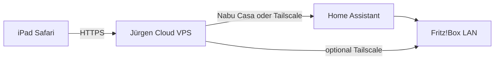

# Jürgen in der Cloud (nicht zu Hause)

Du kannst **Jürgen komplett in der Cloud** betreiben — kein Docker auf dem Mac, kein NAS, kein Raspberry Pi **für die App**.

Was **nicht** geht: Die Fritz!Box-API direkt aus dem Internet aufrufen, als wäre sie eine Website. AVM öffnet TR-064 absichtlich **nicht** nach außen.

Was **geht**: Jürgen läuft auf einem Server (Hetzner, Fly.io, Railway, …) und erreicht dein Zuhause über einen **sicheren Kanal** — ohne dass Jürgen bei dir lokal läuft.

## Architektur (Empfehlung)



| Ziel | Lösung | Etwas zu Hause? |
|------|--------|------------------|
| Sprache, KI, iPad-UI | Cloud-Server + `docker-compose.cloud.yml` | **Nein** |
| Lampen, Steckdosen, „etc.“ | **Home Assistant** + **Nabu Casa** (Remote-URL) | Nur HA (hast du oft schon) |
| Fritz!Box WLAN / Internet / Gast-WLAN | **A)** Fritz!-Integration in HA **oder** **B)** Tailscale ins Heimnetz | **Kein** Jürgen — ggf. HA oder Tailscale-Subnet |

---

## 1. Jürgen in der Cloud starten

### `.env` auf dem Server

```env
PUBLIC_URL=https://juergen.deine-domain.de

# KI in der Cloud (Ollama geht nur, wenn du Ollama auf demselben Server betreibst)
LLM_BASE_URL=https://openrouter.ai/api/v1
LLM_API_KEY=sk-or-...
LLM_MODEL=anthropic/claude-sonnet-4

# Smart Home aus der Ferne
SMART_HOME_PROVIDER=homeassistant
HOMEASSISTANT_URL=https://deinname.ui.nabu.casa
HOMEASSISTANT_TOKEN=eyJ...

# Fritz direkt (nur wenn Cloud-Server das Heimnetz per Tailscale sieht — siehe unten)
FRITZBOX_ENABLED=false
```

Start:

```bash
docker compose -f docker-compose.cloud.yml up -d --build
```

Vor dem iPad: **HTTPS** (Reverse-Proxy mit Let’s Encrypt, Caddy, nginx) und `PUBLIC_URL` setzen — sonst kein Mikrofon in Safari.

### Sicherheit

Jürgen hat **kein Login**. In der Cloud **unbedingt** absichern:

- Cloudflare Tunnel + **Access** (E-Mail-Login)
- oder Basic Auth vor dem Reverse-Proxy
- oder VPN (Tailscale) nur für dein iPad

Passwörter (Fritz, HA-Token, LLM-Key) nur in `.env` auf dem Server.

---

## 2. Heimnetz ohne lokalen Jürgen

### Variante A — Home Assistant + Nabu Casa (am wenigsten Aufwand)

1. Fritz!Box in HA einbinden (offizielle Integration).
2. Nabu Casa aktivieren → Remote-URL + Token.
3. In der Cloud-`.env`: `HOMEASSISTANT_URL` + `HOMEASSISTANT_TOKEN`.
4. Jürgen steuert Geräte und Fritz-Funktionen **über HA** — die Cloud spricht nur mit `*.ui.nabu.casa`.

Fritz-spezifische Sprachbefehle (WLAN-Liste, Gast-WLAN) nutzen dann HA-Entities, sobald du sie in HA hast; die direkten Fritz-Tools brauchst du dafür nicht zwingend.

### Variante B — Tailscale (Fritz!Box direkt aus der Cloud)

1. **Tailscale** auf dem Cloud-Server und auf **einem** Gerät im LAN (z. B. Home Assistant, NAS, Fritz!Box per „Subnet Router“ am HA-Host).
2. Subnet-Route für `192.168.178.0/24` freigeben (Tailscale-Admin).
3. Cloud-`.env`:

```env
FRITZBOX_ENABLED=true
FRITZBOX_HOST=192.168.178.1
FRITZBOX_USER=...
FRITZBOX_PASSWORD=...
```

Jürgen auf dem VPS erreicht `192.168.178.1` **über Tailscale** — weiterhin kein Jürgen bei dir zu Hause.

### Variante C — `./start --public` (Quick-Tunnel)

Nur für **Demos**: Jürgen läuft trotzdem auf **deinem** Rechner. Der Tunnel macht die **Website** öffentlich, **nicht** die Fritz!Box im LAN. Für „nur Cloud“ diese Variante nicht verwenden.

---

## 3. Checkliste

| Schritt | Erledigt |
|---------|----------|
| VPS / Hosting mit Docker | |
| HTTPS + `PUBLIC_URL` | |
| `LLM_*` (OpenRouter/OpenAI) | |
| HA Remote **oder** Tailscale fürs Heimnetz | |
| iPad: Link zum Home-Bildschirm | |

Status: `https://deine-url/api/status` → `llm_configured`, `homeassistant_connected` / `fritzbox_connected`.

---

## Kurzantwort

**Ja, Jürgen darf (und soll) in der Cloud laufen**, wenn du willst. **Fritz!Box & Co.** hängen über **Nabu Casa + Home Assistant** oder **Tailscale** — nicht über „Fritz!Box ins Internet stellen“. Du musst **Jürgen nicht lokal** hosten; oft bleibt nur Home Assistant (oder ein Tailscale-Knoten) im LAN, das ist normal.
