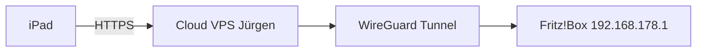

# Nur Fritz!Box — Jürgen in der Cloud

Du hast **kein Home Assistant**, nur eine **Fritz!Box**. Jürgen soll **auf einem Cloud-Server** laufen und trotzdem WLAN-Liste, Internetstatus und Gast-WLAN steuern.

Dafür brauchst du **einen verschlüsselten Tunnel ins Heimnetz**. Am sinnvollsten **nur mit der Fritz!Box** (WireGuard-VPN von AVM) — kein extra Gerät, kein Jürgen zu Hause.

## Übersicht



| Komponente | Wo |
|------------|-----|
| Jürgen (Website + KI + Stimme) | Cloud-VPS |
| VPN ins LAN | **Fritz!Box WireGuard** (empfohlen) |
| Smart Home | aus — `SMART_HOME_PROVIDER=mock` |

---

## Schritt 1 — Fritz!Box vorbereiten

### API-Benutzer (TR-064)

**System → FRITZ!Box-Benutzer → Benutzer anlegen**

- Recht: **FRITZ!Box-Einstellungen** (und **Smart Home**, falls angeboten)
- Name z. B. `JürgenAPI`, starkes Passwort

### WireGuard-Zugang für den Cloud-Server

In der Fritz!Box-Oberfläche (Firmware ab FRITZ!OS 7.39 / WireGuard-Unterstützung):

**Internet → Freigaben → VPN (WireGuard)**  
→ Verbindung für **externen Zugriff** anlegen  
→ Konfiguration **exportieren** (`.conf` für Linux)

Notiere:

- Heimnetz der Box (meist `192.168.178.0/24`, Gateway `192.168.178.1`)
- Ob **MyFritz** / dynamische IP — WireGuard-Konfiguration der Box enthält den Endpoint

> Kein WireGuard-Menü? Firmware aktualisieren oder **IPsec-VPN** der Fritz!Box nutzen (gleiche Idee: VPS verbindet sich in dein LAN). Für IPsec siehe AVM-Hilfe „VPN“; danach gilt für Jürgen dasselbe: Server muss `192.168.178.1` erreichen.

---

## Schritt 2 — Cloud-VPS (z. B. Hetzner, 4–8 €/Monat)

### WireGuard auf dem Server

```bash
sudo apt update && sudo apt install -y wireguard
sudo cp fritz-wireguard.conf /etc/wireguard/wg-fritz.conf
# Datei anpassen: PrivateKey, Address, Peer … aus Fritz-Export
sudo wg-quick up wg-fritz
sudo systemctl enable wg-quick@wg-fritz
```

Test:

```bash
ping -c 2 192.168.178.1
```

Wenn das geht, sieht der **VPS** deine Fritz!Box wie im WLAN.

### Docker: Routing beachten

Container im Standard-Bridge-Netz **sehen oft nicht** die VPN-Route des Hosts. Deshalb für Fritz!Box:

```bash
docker compose -f docker-compose.cloud.yml -f docker-compose.cloud.fritz.yml up -d --build
```

`docker-compose.cloud.fritz.yml` setzt `network_mode: host`, damit Jürgen dieselbe Route wie `ping 192.168.178.1` nutzt.

---

## Schritt 3 — `.env` auf dem VPS

```env
PUBLIC_URL=https://juergen.deine-domain.de

LLM_BASE_URL=https://openrouter.ai/api/v1
LLM_API_KEY=sk-or-...
LLM_MODEL=anthropic/claude-sonnet-4

SMART_HOME_PROVIDER=mock

FRITZBOX_ENABLED=true
FRITZBOX_HOST=192.168.178.1
FRITZBOX_USER=JürgenAPI
FRITZBOX_PASSWORD=...
```

HTTPS vor Jürgen (Caddy/nginx + Let’s Encrypt) — Safari auf dem iPad braucht HTTPS fürs Mikrofon.

---

## Schritt 4 — Prüfen

```bash
curl -s https://juergen.deine-domain.de/api/status | jq
```

Erwartung: `"fritzbox_connected": true`

Sprache:

- „Wer ist im WLAN?“
- „Wie ist der Internetstatus?“
- „Schalte Gast-WLAN an.“

---

## Sicherheit

- **Kein** Port-Forward für TR-064 (Port 49000 o. ä.) ins Internet.
- VPN + **Zugang zu Jürgen absichern** (Cloudflare Access, Basic Auth) — die App hat kein Login.
- Fritz-Passwort nur in `.env` auf dem VPS.

---

## Alternative: Tailscale (nur wenn du ein LAN-Gerät dauerhaft an hast)

Ohne Fritz-WireGuard: Tailscale auf VPS + auf **einem** Gerät im LAN mit Subnet-Router `192.168.178.0/24`. Dann ebenfalls `FRITZBOX_HOST=192.168.178.1` und `docker-compose.cloud.fritz.yml`.

---

## Was Jürgen **ohne** HA nicht kann

Nur über die Fritz!Box-API abgedeckt: Geräte im WLAN, WAN-Status, Gast-WLAN.  
Steckdosen/DECT **nur an der Fritz!Box** ginge über AVM Smart Home — ist im Code noch nicht angebunden. Wenn du das willst, sag Bescheid.
